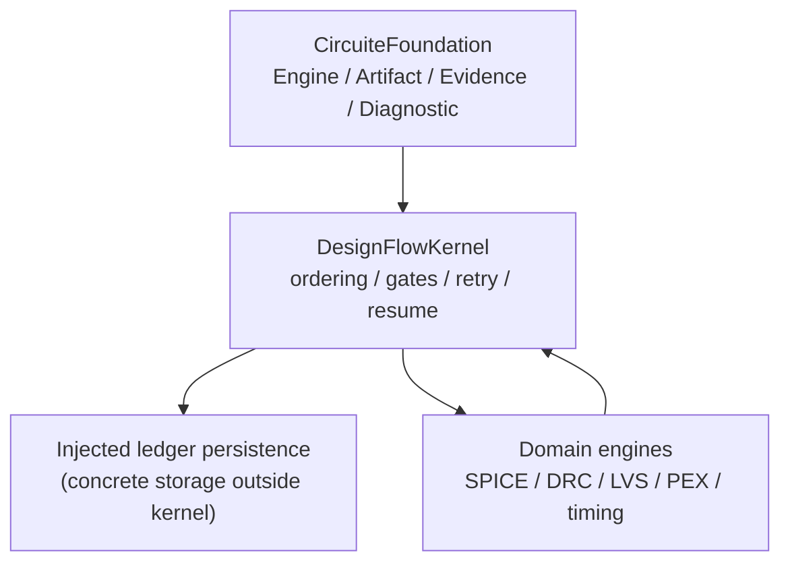

# DesignFlowKernel design

## Responsibility boundary

DesignFlowKernel coordinates a semiconductor design flow. It does not
implement domain algorithms and it does not become a project model. Domain
engines remain independently executable and are supplied through
`FlowStageExecutor`.



## Shared contract integration

- `FlowEngine` is the typed `CircuiteFoundation.Engine` boundary.
- `DefaultFlowEngine` invokes the orchestrator without a bridge or result
  projection layer.
- `FlowRunResult` directly provides `EvidenceManifest`, canonical artifact
  references, `DesignDiagnostic` values, and mandatory `ExecutionProvenance`.
- `FlowRunLedgerPersisting` is the asynchronous storage seam for run recovery.
  Implementations own durable writes and integrity checks; the kernel does not
  choose a filesystem layout.
- `FlowRunReviewLedgerLoading` loads structurally validated ledger metadata for
  review. Review then verifies every artifact independently, while resume,
  approval, and release continue to use an attested `FlowRunLedgerLoading`
  implementation.
- `FlowArtifactPersisting` is the canonical artifact seam. It persists, loads,
  and verifies `CircuiteFoundation.ArtifactReference` values while leaving the
  concrete namespace and filesystem boundary to the injected implementation.
- `FlowRunInfrastructure` composes artifact, run-control, ledger-loading,
  workspace-preparation, progress, evidence, and ToolQualification
  artifact-reading capabilities for orchestration without introducing a
  storage facade. Stage executors consume this protocol rather than opening a
  concrete ledger file.
- `FlowOperationRequest`, stage results, and the run ledger remain domain and
  persistence models owned by this package.

## Runtime flow

1. A caller creates a `FlowEngineRequest` with a `FlowOperationRequest`, tool
   registry, health results, and stage executors.
2. `DefaultFlowEngine.execute` delegates to `DefaultFlowOrchestrator`.
3. The orchestrator validates the plan, selects trusted tools, executes stages,
   records diagnostics and artifacts, and applies approval gates.
4. A `FlowRunLedgerPersisting` implementation persists the run so a later
   invocation can resume the same run. The composing application supplies the
   concrete storage implementation bound to a validated `FlowWorkspaceID`.
   If resume setup fails after the run returns to `running`, failure
   finalization appends the `flow-setup` result and tool record without
   discarding already retained stage or toolchain history.
5. The orchestrator emits a `FlowRunResult` whose evidence and diagnostics are
   immediately consumable through CircuiteFoundation protocols.
6. Review artifacts embed `ArtifactReference` as the single source of artifact
   identity, location, role, kind, format, digest, and byte count. DesignFlowKernel
   stores only review-domain metadata such as the validated open-token
   `FlowRunReviewArtifactPurpose`, `stageID`, and the verification result beside
   that reference.

## Deliberate non-goals

- No universal result envelope is introduced.
- No project lifecycle or UI state is moved into Foundation.
- No domain-specific artifact formats are interpreted by the kernel.
- Concrete Xcircuite workspace storage is not part of the kernel contract.

## Artifact materialization aliases

`FlowArtifactBinding` separates a stage-local logical ID, the typed content
reference, and physical availability. Stage logical IDs are unique. A physical
materialization may retain multiple semantic bindings when every binding has the
same exact `ArtifactID` and producer, including an identical absent producer.
Different descriptors are retained as declared semantics rather than interpreted
by the kernel. Conflicting digests, byte counts, or producers at one materialization
are rejected before stage publication and terminal ledger finalization.

```text
Physical availability -> one exact content ID and producer
                      -> multiple immutable logical IDs and descriptors
```

`mergedArtifactBindings` owns shared materialization admission for stage and ledger
composition. Run manifests and terminal projections preserve the same admission
invariant. Evidence retains every typed reference, including repeated references
associated with distinct logical aliases. Review preserves stage bindings; explicit
stage selectors remain the composing application's responsibility. No domain role,
storage copy, or descriptor transformation is introduced here.

`FlowRunLedgerCoordinatorTests` verifies actual stage validation, alias-preserving
terminal finalization and reload, unique logical IDs, and rejection of conflicting
content/producer across stage, merger, and run-manifest boundaries. This contract
affects composing applications' stage artifact coverage, exact-reference availability
resolution, and immutable retained-ledger comparisons.

## Qualification Fixture Retention

[QualificationOriginalRetentionTests](Tests/DesignFlowKernelTests/QualificationOriginalRetentionTests.swift)
verifies the model-free corpus fixture's exact original output, completed phase
and metric binding through record issuance and validation. Explicit corpus-required trust evaluation
refuses missing or same-size altered originals. The fixture has no oracle case or
process qualification and establishes no model coverage. The canonical execution
schema remains owned by [ToolQualification](../ToolQualification/DESIGN.md).
